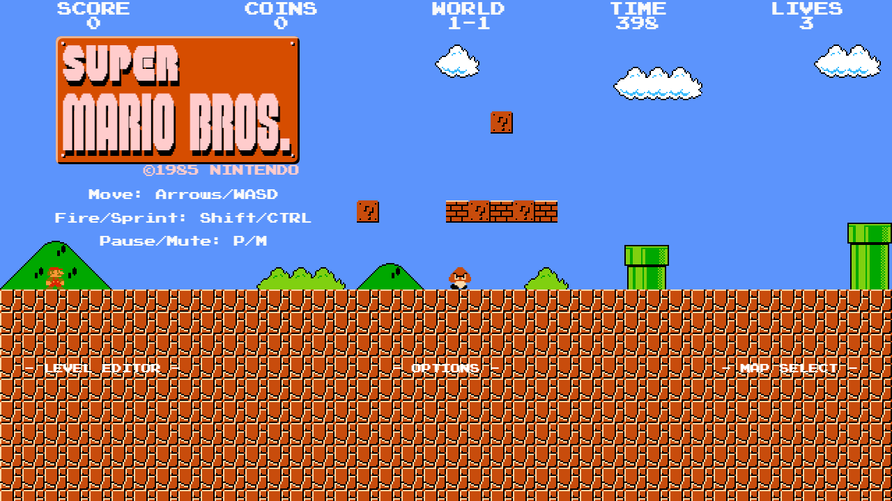

# Mario

**Live demo:** https://chandrasen74.github.io/Mario/  
**Repository:** https://github.com/Chandrasen74/Mario



## Overview
`Mario` is a HTML/CSS/JavaScript project.
- **Primary language:** JavaScript
- **Languages detected:** JavaScript, CSS, HTML
- **Stack/tech:** HTML, CSS, JavaScript
- **Entry point:** `index.html`
- **Key files:** `index.html`

## Language & stack details
- Languages: JavaScript, CSS, HTML
- Frameworks/tools/libraries: HTML, CSS, JavaScript

## How to install & run
### Prerequisites
- A modern web browser
- (Optional) [Python 3](https://www.python.org/) or any static file server for local serving

### Run locally
```bash
git clone https://github.com/Chandrasen74/Mario.git
cd Mario
```
- **Option 1:** open `index.html` directly in your browser
- **Option 2:** serve locally (recommended for some JS features):
```bash
python -m http.server 8000
# then open http://localhost:8000
```

## Repository structure (top-level/sample)
- `Fonts/generator_config.txt`
- `Fonts/pressstart2p-webfont.eot`
- `Fonts/pressstart2p-webfont.svg`
- `Fonts/pressstart2p-webfont.ttf`
- `Fonts/pressstart2p-webfont.woff`
- `Fonts/specimen_files/easytabs.js`
- `Fonts/specimen_files/grid_12-825-55-15.css`
- `Fonts/specimen_files/pressstart2p-cleartype.png`
- `Fonts/specimen_files/specimen_stylesheet.css`
- `Fonts/specimen_files/super_plumber_brothers-cleartype.png`
- `Fonts/stylesheet.css`
- `Fonts/super_plumber_brothers-demo.html`
- `Fonts/super_plumber_brothers-webfont.eot`
- `Fonts/super_plumber_brothers-webfont.svg`
- `Fonts/super_plumber_brothers-webfont.ttf`
- `Fonts/super_plumber_brothers-webfont.woff`
- `Maps/World12.js`
- `Maps/World13.js`
- `Maps/World14.js`
- `Maps/World21.js`
- `Maps/World22.js`
- `Maps/World23.js`
- `Maps/World24.js`
- `Maps/World31.js`
- `Maps/World32.js`
- `Maps/World33.js`
- `Maps/World34.js`
- `Maps/World41.js`
- `Maps/World42.js`
- `Maps/World43.js`
- `Maps/World44.js`
- `Maps/World51.js`
- `Maps/World52.js`
- `Maps/World53.js`
- `Maps/World54.js`
- `Maps/World61.js`
- `Maps/World62.js`
- `Maps/World63.js`
- `Maps/World64.js`
- `Maps/World71.js`
- ... and 136 more file(s)

## Status
Documented with screenshot, language/stack details, and setup instructions as part of a profile-wide README update.
